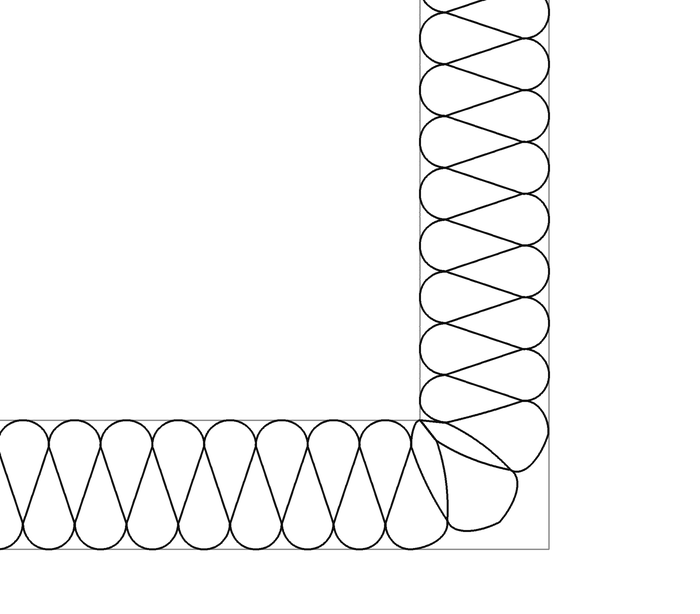

# Batting

A Rhino 8 plug-in that draws the batting (insulation) symbol, like AutoCAD's
BATTING linetype, and keeps it in step with the curve it follows: straight,
curved or closed walls, with corners rounded off.


## Install

In Rhino 8 open the **Package Manager** (`_PackageManager`), search for
**Batting** and click **Install**, then restart Rhino.

Requires Rhino 8 for Windows.

## Use

### Draw a batting: `Batting`

Click the points of a polyline along the **middle** of the insulation layer,
then press Enter. While you draw, you see the batting it will make.

| Option | |
|---|---|
| `Width` | The thickness of the insulation. Type a value or pick two points to measure it. |
| `Shape` | From 0, a zig-zag, to 1, loops (the default). See [Shape](#shape). |
| `Close` | Close the polyline. |
| `Undo` | Remove the last point. |

### Turn curves into batting: `CurveToBatting`

Select curves running along the middle of the insulation (lines, arcs,
circles, polylines, splines, polycurves) and give the width. With
`DeleteInput=Yes` each curve becomes the batting and keeps its layer, colour
and linetype; with `No` the batting is added beside it.

The last width and shape you used are remembered for next time.

### Edit a batting

Click a batting and its base curve appears with its points as grips. Drag a
grip and the batting follows. Click elsewhere, or press Esc, to hide them
again. F10 (PointsOn) shows the same base grips.


A batting is an ordinary curve, so layer, colour, linetype and print width
work as they do on any curve. Move, Rotate, Mirror, Scale, Copy and Undo all
carry it along. Opened in a Rhino without the plug-in, it is simply a curve.

### The Properties panel

With a batting selected, the **Properties** panel has a Batting page (the
loops icon):


- **Width**: type a value and press Enter, or click **Pick** to measure it
  between two points.
- **Shape**: drag the slider from 0 (zig-zag) to 1 (loops).
- **Exclusions**: how many there are. **Add** asks for closed curves to cut
  out; **Clear** removes them all.

With several battings selected, a change applies to all of them as one undo
step.

### Shape

Shape sets the size of the loops on the faces. At 0 they shrink to points,
leaving a zig-zag; at 0.5 the lines between them run straight across; at 1
they are half circles and the lines cross.


### Exclusions: `BattingExclude`

Cut a batting away inside closed curves, for example around a steel profile
passing through the insulation. Select the battings, then the closed curves
(the **Add** button on the Properties page does the same). `Clear` removes
all exclusions.

An exclusion lying inside another one makes a hole in it, as with nested
hatch boundaries. Pick a tube's outer and inner outline and the batting is
cut away only in the tube's wall.


The exclusions are copies of the curves you picked and move with the
batting; the curves themselves are left alone. A batting cut into several
pieces is a group: clicking any piece selects all of it.

### Curves and corners

The pattern bends along curves, and an open batting starts and ends halfway
round a loop, square with the ends of its base. Sharp corners are rounded on
the centreline so the batting turns the corner without folding over itself.




### Change the width later: `BattingWidth`

Select battings and give a new width, typed or picked. The Properties page
does the same.

## Good to know

- Base points can be moved but not added or removed; redraw the batting for
  that.
- Scale changes the width with it. Scaling unevenly distorts the pattern until
  the batting is next edited.
- To change an exclusion's shape, Clear the exclusions and add them again.

## Build from source

```bash
dotnet build Batting.csproj -c Release
```

The plug-in is `bin/Release/net7.0-windows/Batting.rhp`; drag it into Rhino
to load it. RhinoCommon comes from NuGet, built against Rhino 8.0 so it loads
in every Rhino 8.

To package it for the Package Manager, copy the `.rhp` into `dist/` and run
`"C:\Program Files\Rhino 8\System\Yak.exe" build --platform win` there.

| File | |
|---|---|
| `BattingPattern.cs` | Builds the pattern, bends it along the base and cuts out exclusions. |
| `BattingData.cs` | The data stored on each batting: base curve, width, shape, drawing plane, exclusions. |
| `BattingSet.cs` | Finds the pieces of a cut batting and rebuilds them together. |
| `BattingGrips.cs` | The grips on the base curve. |
| `BattingDisplay.cs` | Draws the base and exclusions of selected battings. |
| `BattingPlugIn.cs` | Turns the grips on and off as battings are selected. |
| `BattingCommands.cs` | The four commands. |
| `BattingPropertiesPage.cs` | The Batting page in the Properties panel. |

## License

MIT
