# Batting

A Rhino 8 plug-in that draws the batting (insulation) symbol, like AutoCAD's
BATTING linetype, and keeps it in step with the curve it follows: straight,
curved or closed walls, centred on its curve or to one side, with fanned,
butt or mitred corners. It can also fill the layer between two curves where
the thickness varies, and comes with Grasshopper components.

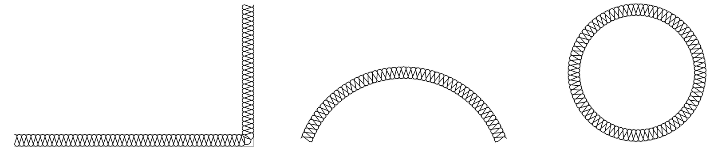

## Install

In Rhino 8 open the **Package Manager** (`_PackageManager`), search for
**Batting** and click **Install**, then restart Rhino. The
[Grasshopper components](#grasshopper) come with it.

Requires Rhino 8. Released versions are for Windows; see
[Rhino for Mac](#rhino-for-mac).

### Versions

| Version | |
|---|---|
| 1.2.1 | `CurveToBatting` is now `BattingFromCurve`, so every command starts with Batting; the old name still works. Not released yet. |
| 1.2.0 | Alignment, faces and spacing; batting between two curves; output as lines and arcs; `SelBatting` and `BattingMatch`; Grasshopper components. |
| 1.1.0 | Corner types: Fan, Butt and Mitre. `BattingExtractBase` gets the base curve back. |
| 1.0.0 | First release; corners are rounded off. |

Every published version stays on the Package Manager, so an older one can
still be installed. The [Releases](https://github.com/pbrgle1/Batting/releases)
page has each version's notes and files, and each version's code is tagged
(`v1.0.0`, `v1.1.0`, `v1.2.0`). Battings drawn with a newer version still
open in an older one, which draws them the way it knows when they are next
edited.

## Use

### Draw a batting: `Batting`

Click the points of a polyline along the insulation layer, then press Enter.
While you draw, you see the batting it will make.

| Option | |
|---|---|
| `Width` | The thickness of the insulation. Type a value or pick two points to measure it. |
| `Shape` | From 0, a zig-zag, to 1, loops (the default). See [Shape](#shape). |
| `Spacing` | How far apart the loops are, from 0.5 to 2; 1 is standard. See [Spacing](#spacing). |
| `Corners` | How sharp corners are turned: `Fan` (the default), `Butt` or `Mitre`. See [Corners](#corners). |
| `Align` | Where the batting lies: `Centre` on the polyline (the default), or to its `Left` or `Right`. See [Alignment and faces](#alignment-and-faces). |
| `Faces` | Also draw the two faces of the insulation layer. |
| `Close` | Close the polyline. |
| `Undo` | Remove the last point. |

### Turn curves into batting: `BattingFromCurve`

Select curves (lines, arcs, circles, polylines, splines, polycurves) and give
the width; the options above are offered too. With `DeleteInput=Yes` each
curve becomes the batting and keeps its layer, colour and linetype; with `No`
the batting is added beside it.

Up to 1.2.0 this command was called `CurveToBatting`. That name still works,
so existing aliases, macros and toolbar buttons keep working; it just
doesn't show in autocomplete.

The last width and options you used are remembered for next time.

### Fill the layer between two curves: `BattingBetween`

Select the two faces of the insulation layer, for example the top of a
sloping roof deck and a level ceiling. The batting fills the space between
them and follows its thickness: where the layer is thinner the loops are
smaller. Options: `Shape`, `Spacing`, `Faces` and `DeleteInput`.

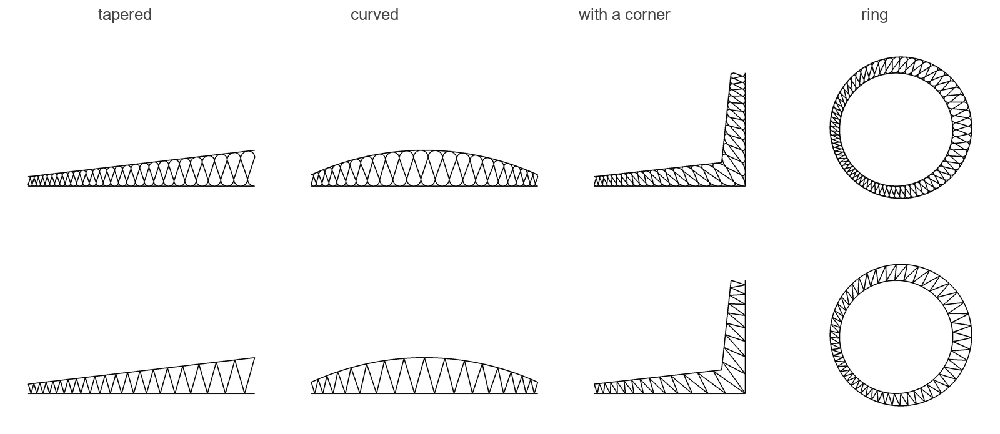

The two faces are matched along their length. Faces that both have corners,
the same number of them, are matched corner to corner, and the batting turns
each corner along the line joining the two faces' corners. Select such a
batting and both faces show, with grips on each.

### Edit a batting

Click a batting and its base curve appears with its points as grips. Drag a
grip and the batting follows. Click elsewhere, or press Esc, to hide them
again. F10 (PointsOn) shows the same base grips.

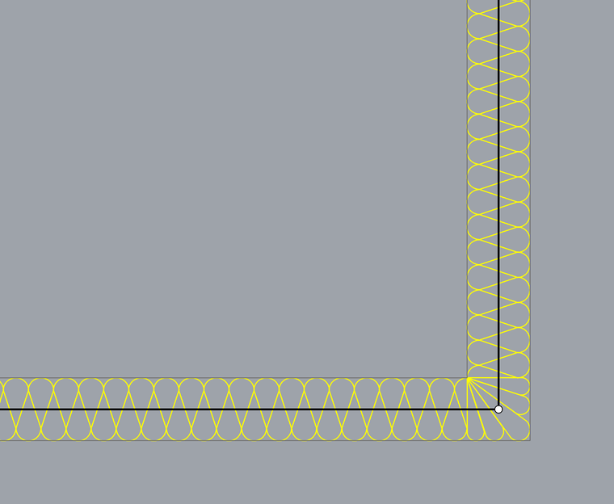

A batting is an ordinary curve, so layer, colour, linetype and print width
work as they do on any curve. Move, Rotate, Mirror, Scale, Copy and Undo all
carry it along. Opened in a Rhino without the plug-in, it is simply a curve.

### The Properties panel

With a batting selected, the **Properties** panel has a Batting page (the
loops icon):

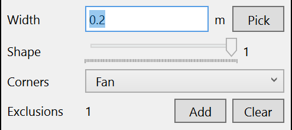

- **Width**: type a value and press Enter, or click **Pick** to measure it
  between two points.
- **Shape** and **Spacing**: drag the sliders.
- **Corners**: Fan, Butt or Mitre.
- **Align**: Centre, Left or Right; Centre, Inside or Outside for closed
  curves.
- **Faces**: draw the faces of the insulation layer.
- **Exclusions**: how many there are. **Add** asks for closed curves to cut
  out; **Clear** removes them all.

With several battings selected, a change applies to all of them as one undo
step. A batting between two curves takes its width from the curves, so Width,
Corners and Align don't apply to it.

### Shape

Shape sets the size of the loops on the faces. At 0 they shrink to points,
leaving a zig-zag; at 0.5 the lines between them run straight across; at 1
they are half circles and the lines cross.

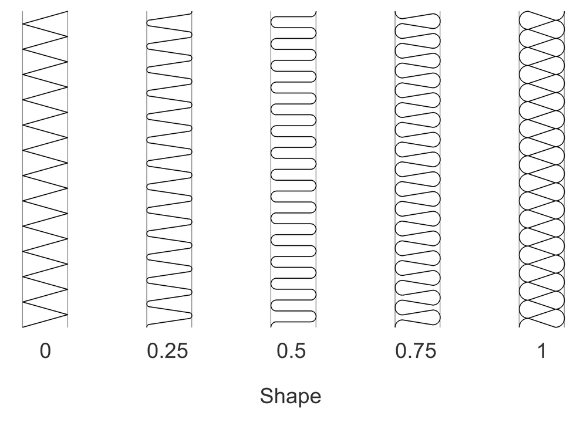

### Spacing

Spacing sets how far apart the loops are. Below 1 they move closer and get
smaller; above 1 they keep their size and move apart, which opens the coil
into an S-shaped line.

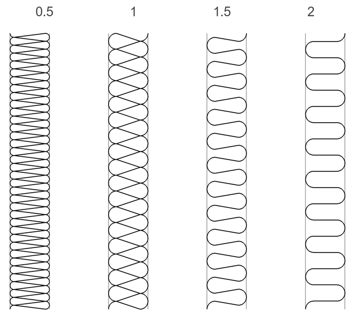

### Alignment and faces

A batting is centred on its curve, or lies to its left or right as the curve
runs. That way a curve along the face of a wall can carry the insulation on
one side of it. On a closed curve, left is inside and right outside. With
**Faces** on, the batting also draws the two faces of the insulation layer,
which follow it through every edit.

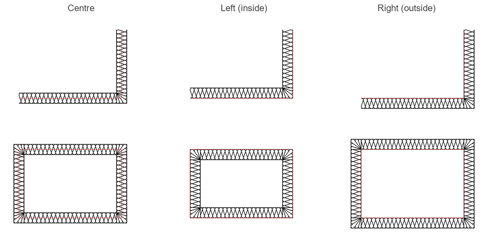

### Corners

Where the base has a sharp corner, the batting turns it in one of three ways:

- **Fan** (the default): the loops fan out from the inside of the corner and
  grow to fill the outside of it, all in one curve.
- **Butt**: the batting is interrupted, like two boards butted together. The
  first run carries on to the outer face of the second, and the second starts
  against it. At corners sharper than a right angle, each run is cut along
  the face it meets.
- **Mitre**: both runs carry on to the outer corner and are cut along the
  diagonal from the inside corner to the outside one, which is drawn as the
  joint.

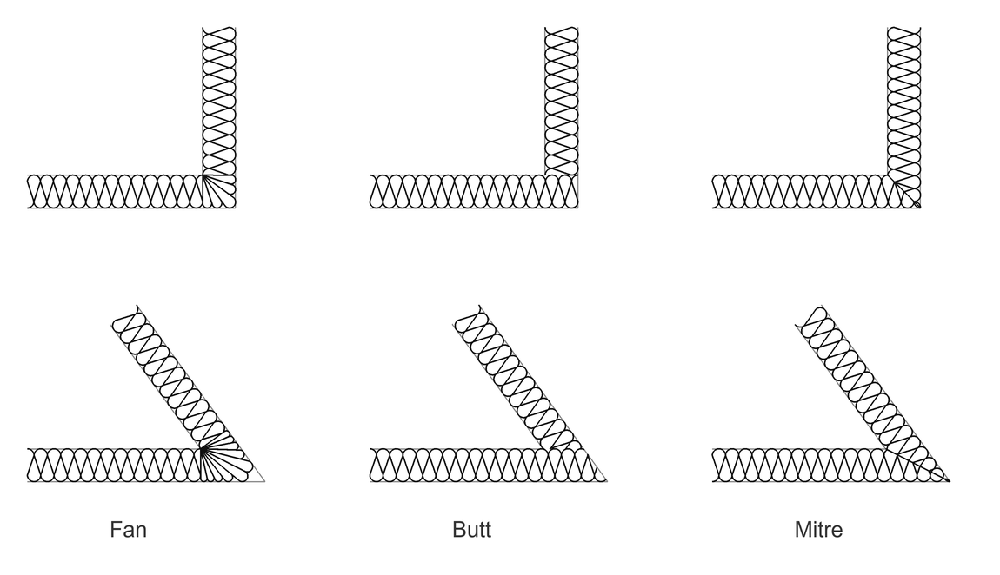

Butt and Mitre battings are made of several curves, grouped like a batting
cut by exclusions. A corner too sharp to fan, with walls meeting at under
about 30°, gets a butt joint instead; where a segment is too short for the
fan, the corner is rounded off.

### Curves

The pattern bends along curves, and an open batting starts and ends halfway
round a loop, square with the ends of its base.

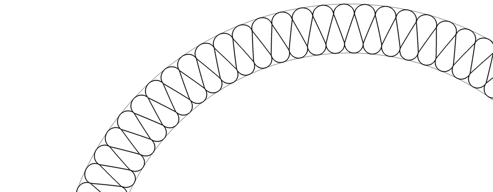

### Exclusions: `BattingExclude`

Cut a batting away inside closed curves, for example around a steel profile
passing through the insulation. Select the battings, then the closed curves
(the **Add** button on the Properties page does the same). `Clear` removes
all exclusions.

An exclusion lying inside another one makes a hole in it, as with nested
hatch boundaries. Pick a tube's outer and inner outline and the batting is
cut away only in the tube's wall.

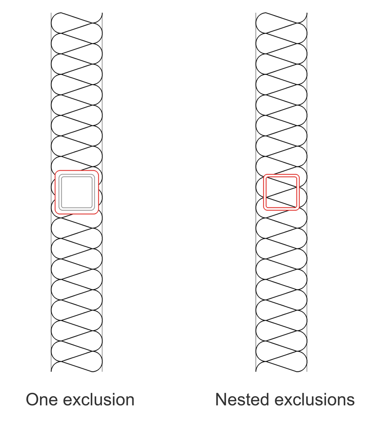

The exclusions are copies of the curves you picked and move with the
batting; the curves themselves are left alone. A batting cut into several
pieces is a group: clicking any piece selects all of it.

### Change the width later: `BattingWidth`

Select battings and give a new width, typed or picked. The Properties page
does the same.

### Get the base curve back: `BattingExtractBase`

Select battings to get a copy of the curve each one follows, as an ordinary
curve on the current layer; for a batting between two curves, both faces.
The copies are left selected, ready to use, and the battings stay as they
are.

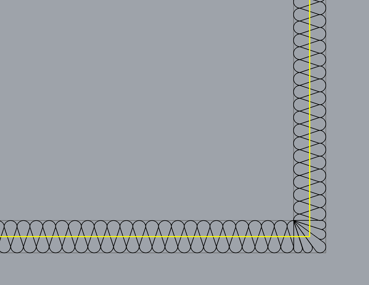

### Select and match: `SelBatting` and `BattingMatch`

`SelBatting` selects all battings. `BattingMatch` works like Rhino's
MatchProperties. Select the battings to change, then the batting to match,
and they take its width, shape, spacing, corners, alignment and faces.

### Export to AutoCAD

A batting is made of true lines and arcs, so DWG and DXF exports get lines
and arcs rather than splines. Battings along straight lines are exact. Along
curves, the bent loops are fitted with arcs that stay within a thousandth of
the width.

## Grasshopper

Two components are in the **Batting** tab:

- **Batting** draws a batting along a curve. Inputs: Curve, Width, Shape,
  Spacing, Corners, Align, Faces and Exclusions. Right-click Corners or Align
  for their named values.
- **Batting Between** fills the layer between two curves. Inputs: Face A,
  Face B, Shape, Spacing, Faces and Exclusions.

Both output the batting curves (B) and the faces (F). **Bake** a component,
not its output, to get real battings in Rhino that you can keep editing with
grips and the Properties panel. Baking the output curves gives plain curves.

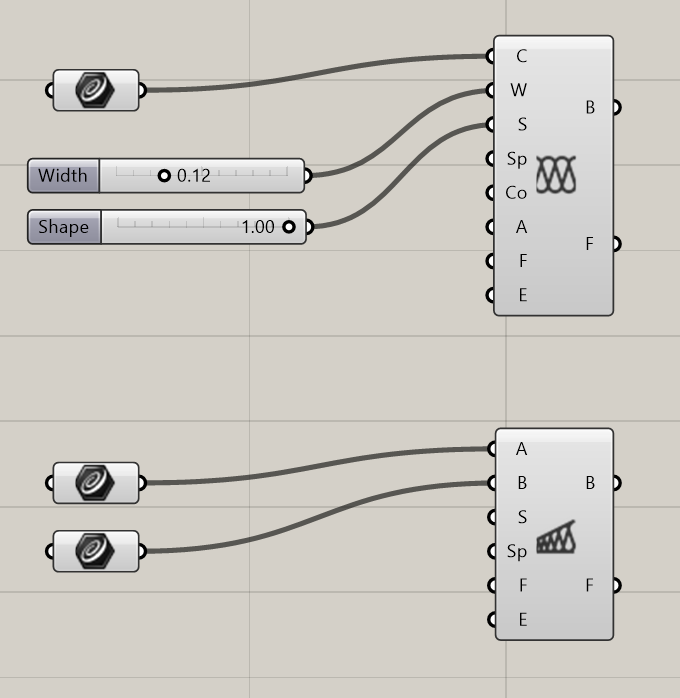

## Good to know

- Base points can be moved but not added or removed. To do that, take the
  base out with `BattingExtractBase`, edit it, and turn it into a batting
  again with `BattingFromCurve`.
- Scale changes the width with it. Scaling unevenly distorts the pattern until
  the batting is next edited.
- To change an exclusion's shape, Clear the exclusions and add them again.
- Between two curves, the loops lean where one face is much longer than the
  other, for example near a corner, because the faces are matched by length.

## Rhino for Mac

Since 1.2 the plug-in and the Grasshopper components have no Windows-only
parts, so they should load in Rhino 8 for Mac too. So far they have only been
tried on Windows, and released versions are packaged for Windows.

## Build from source

```bash
dotnet build Batting.csproj -c Release
dotnet build Grasshopper/BattingGH.csproj -c Release
```

The plug-in is `bin/Release/net7.0/Batting.rhp`; drag it into Rhino to load
it. The Grasshopper components are
`Grasshopper/bin/Release/net7.0/BattingGH.gha`. RhinoCommon and Grasshopper
come from NuGet, built against Rhino 8.0 so they load in every Rhino 8.

To package them for the Package Manager, copy both into `dist/` and run
`"C:\Program Files\Rhino 8\System\Yak.exe" build --platform win` there.

| File | |
|---|---|
| `BattingPattern.cs` | Builds the pattern, along a curve or between two, bends it into place, turns the corners and cuts out exclusions. |
| `BattingStyle.cs` | The style settings: shape, spacing, corners, alignment, faces. |
| `BattingData.cs` | The data stored on each batting: base curve (and second face), width, style, drawing plane, exclusions. |
| `BattingSet.cs` | Finds the pieces of a cut batting and rebuilds them together. |
| `BattingGrips.cs` | The grips on the base curve. |
| `BattingDisplay.cs` | Draws the base and exclusions of selected battings. |
| `BattingPlugIn.cs` | Turns the grips on and off as battings are selected, and remembers the last settings. |
| `BattingCommands.cs` | The commands. |
| `BattingPropertiesPage.cs` | The Batting page in the Properties panel. |
| `Grasshopper/BattingComponents.cs` | The Grasshopper components. |

## License

MIT
